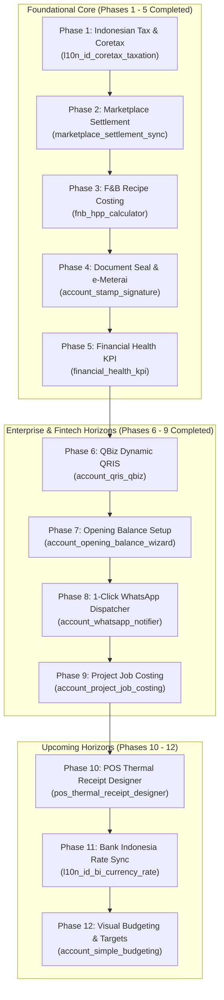

# MangoTek Financial Suite — Agent & AI Developer Operating Guidelines (AGENTS.md)

> **Mandatory Operating Standards for AI Coding Agents, Contributors, and Automation Bots**  
> **Applies to:** Odoo 18.0, 19.0 & 20.0 (Community & Enterprise Architecture)  
> **License:** LGPL-3.0 · **Organization:** Mango Teknusa Inovasi (`billing@ppti.me`)

---

## 1. Prime Directive: Zero AI Slop & High-Integrity Financial Engineering

As an AI agent developing for **MangoTek Financial Suite**, your primary objective is to produce production-grade, maintainable, and mathematically immutable code that feels as if it were authored by senior Odoo core framework engineers and certified public accountants. Generic AI placeholders, hallucinations, bloated boilerplate, and superficial comments are strictly forbidden.

### Core Agent Tenets
1. **Never Touch What Isn't Broken**: When modifying existing code, make surgical, precise edits. Do not rewrite surrounding functions, change unrelated logic, or reformat untouched files.
2. **Deterministic Financial Math**: Never use floating-point divisions without rounding (`round(val, 2)` or `currency.round()`). Double-entry balance sheet equations must balance to `0.00` with zero rounding leakage.
3. **No Phantom Imports / No Mock Hallucinations**: Every dependency must exist in Odoo 18 core or within the suite's manifest declarations. When third-party packages (e.g. `openpyxl`, `qrcode`, `dateutil`) are utilized, provide safe runtime fallbacks (`try ... except ImportError`) so test suites can run anywhere.
4. **Indonesian Statutory Precision**: Ground all tax and regulatory calculations on official Indonesian statutes:
   - **PPN 12%**: UU HPP (Harmonisasi Peraturan Perpajakan).
   - **PPh Final UMKM 0.5%**: PP 20/2026.
   - **Coretax & e-Faktur 4.0**: PER-03/PJ/2022 & PMK 112/2022 (NPWP 16 & NITKU 22 digit).
   - **e-Meterai Rp 10.000**: UU No. 10/2020 on Bea Meterai.
   - **Dynamic QRIS**: Bank Indonesia & ASPI EMVCo standards.
   - **Asset Depreciation**: UU PPh Pasal 11 straight-line fiscal rates.

---

## 2. Phased Roadmap Execution & Milestone Governance (MANDATORY)

All AI agents and developers working on this codebase **MUST** understand and respect the 12-phase master roadmap defined in `ROADMAP.md`. You must never jump ahead to downstream modules before the foundational models in prior phases are verified and stable.



### Module Ownership & Dependency Chain:
1. **`l10n_id_coretax_taxation`**: Depends on `base`, `account`. Extends `res.partner` (NPWP16, NITKU22), `account.move` (NSFP sequence, Coretax export), and `l10n_id.nsfp.range`.
2. **`marketplace_settlement_sync`**: Depends on `base`, `account`, `mail`. Manages settlement accounts, import parsers, and commission split entries.
3. **`fnb_hpp_calculator`**: Depends on `base`, `product`, `mail`. Standalone agile portion costing, packaging allocation, and margin badges.
4. **`account_stamp_signature`**: Depends on `base`, `account`, `mail`. Digital stamp overlay and Peruri e-Meterai gateway.
5. **`financial_health_kpi`**: Depends on `base`, `account`, `mail`. Non-invasive read-only KPI computation from standard General Ledger.
6. **`account_qris_qbiz`**: Depends on `base`, `account`, `mail`. Standalone EMVCo Tag 54 injection, unique code suffix, and webhook reconciler.
7. **`account_opening_balance_wizard`**: Depends on `base`, `account`, `stock`, `mail`. Single-window onboarding wizard, multi-sheet Excel engine, and `account.simple.asset` (PPh 11 register).
8. **`account_whatsapp_notifier`**: Depends on `base`, `account`, `mail`. Multi-engine dispatcher (GOWA self-hosted, Meta Cloud API, wa.me fallback), template engine, and interactive composer.
9. **`account_project_job_costing`**: Depends on `base`, `account`, `mail`. Agile project cost sheet, dual-metric P&L (Accrual vs Real Cashflow), budget variance, and Indonesian WHT sensitivity.
10. **`pos_thermal_receipt_designer`**: Depends on `base`, `account`, `mail`. Visual 58mm & 80mm thermal receipt designer, pure ESC/POS byte generator, 1-bit monochrome dithering, and dynamic QRIS.
11. **`l10n_id_bi_currency_rate`**: Depends on `base`, `account`. Official Bank Indonesia JISDOR and Kurs Transaksi BI currency rate auto-sync with multi-provider fallback.

---

## 3. Multi-Version Branching Governance (Odoo 18.0, 19.0, & 20.0)

> [!IMPORTANT]
> **MULTI-VERSION BRANCH MANDATE:** MangoTek Financial Suite officially supports and maintains three dedicated Odoo major version tracks. All AI agents, contributors, and automated pipelines **MUST** provide, test, and synchronize code across the corresponding Git branches before completing any phase:
> - **Branch `18.0`**: Targeted for Odoo 18.0 LTS (Community & Enterprise). Manifest version `'18.0.x.y.z'`.
> - **Branch `19.0`**: Targeted for Odoo 19.0. Manifest version `'19.0.x.y.z'`.
> - **Branch `20.0`**: Targeted for Odoo 20.0. Manifest version `'20.0.x.y.z'`.
> - **Branch `main`**: Default development and production baseline, synchronized with the active stable LTS branch.

### Version Synchronization & Execution Rules:
1. **Branch-Specific Semantic Versioning**:
   - On branch `18.0` and `main`, all `__manifest__.py` files MUST declare versions starting with `18.0.` (e.g., `'18.0.1.0.0'`).
   - On branch `19.0`, all `__manifest__.py` files MUST declare versions starting with `19.0.` (e.g., `'19.0.1.0.0'`).
   - On branch `20.0`, all `__manifest__.py` files MUST declare versions starting with `20.0.` (e.g., `'20.0.1.0.0'`).
2. **Cross-Branch Synchronization Gate**:
   - Whenever a new module or phase is completed on `main`, the agent **MUST** merge and propagate the implementation to local branches `18.0`, `19.0`, and `20.0`.
   - Never leave downstream release branches out of sync.
3. **API & View Syntax Compatibility Across Versions**:
   - **Tabular Views**: In Odoo 18, 19, and 20, tabular views **MUST** use `<list>` (or `<tree>` where parent views in Odoo core still mandate it) without deprecated parameters.
   - **Kanban Templates**: Kanban views **MUST** use modern `<t t-name="card">` syntax rather than legacy `kanban-box`.
   - **Scheduled Actions (`ir.cron`)**: In Odoo 18+, never declare deprecated XML attributes like `numbercall`.
   - **Python Compatibility**: Code must run seamlessly on Python 3.10, 3.11, and 3.12+.

---

## 4. Cross-Module Co-Existence & Anti-Collision Protocols (CRITICAL)

> [!IMPORTANT]
> **ZERO PLUGIN CRASH INVARIANT**: Every module in the MangoTek Financial Suite is designed to be fully modular. A customer may choose to install any combination of modules (e.g. only `account_qris_qbiz` + `fnb_hpp_calculator`, or all 7 modules simultaneously). **No module may crash, collide with, or override the behavior of another module or standard Odoo core.**

### A. Strict XPath & View Inheritance Safety
- **NEVER** use fragile absolute index XPaths:
  ```xml
  <!-- FORBIDDEN (Will break when another module inserts a notebook page): -->
  <xpath expr="//sheet/notebook[1]/page[3]" position="after">

  <!-- MANDATORY (Anchor to named attributes or unique element IDs): -->
  <xpath expr="//page[@name='other_info']" position="after">
  <xpath expr="//field[@name='partner_id']" position="after">
  ```
- **Always Provide Explicit `name` Attributes** on new pages, groups, buttons, and notebook tabs so downstream modules can safely anchor to them.
- **Never Overwrite Existing Buttons**: When adding actions to header buttons (e.g. `action_post`), use standard Python method inheritance `super().action_post()` rather than replacing view buttons.

### B. Field & Model Namespace Prefixing
- To avoid field name collisions on extended core models (`account.move`, `res.partner`, `res.company`):
  - Prefix CoreTax fields with `l10n_id_` (e.g. `l10n_id_tax_number`, `l10n_id_nitku`).
  - Prefix Stamp & Meterai fields with `emeterai_` or `stamp_`.
  - Prefix QRIS fields with `qris_`.
  - Prefix Opening Balance fields with `is_opening_balance`.
- Standalone models must have clear dot-separated namespaces: `fnb.recipe`, `marketplace.settlement.batch`, `financial.health.kpi`, `account.simple.asset`.

### C. Registry & Dependency Isolation
- Never add a hard import `from odoo.addons.sibling_module import ...` unless `sibling_module` is explicitly declared in `'depends'` in `__manifest__.py`.
- For optional interoperability, check model existence dynamically:
  ```python
  if 'fnb.recipe' in self.env:
      # Optional cross-feature logic
  ```
- Use `raise_if_not_found=False` when calling `self.env.ref()` to prevent crashes if an optional XML record is not loaded.

### D. General Ledger Clearing Invariants
- When generating subledgers (e.g. Opening Balance customer invoices and vendor bills), always use dedicated zero-balance clearing accounts.
- **Zero Variance Rule**: The net balance across all interim clearing lines within an onboarding or synchronization transaction must sum to exactly `0.00`.

---

## 5. Brand, Logo & Banner Architecture Standards

> [!CAUTION]
> **NO ARBITRARY DESIGNS:** Inconsistent banner designs, arbitrary card plates, random font choices, or missing open-source badges (as previously occurred with `account_qris_qbiz`) are **STRICTLY PROHIBITED**. All banners and icons must strictly comply with `BRANDKIT.md`.

### A. Standardized Module Banner Specification (`1200 x 630 px`)
All module cover banners (`static/description/banner.png`) **MUST** follow the unified geometry defined in `BRANDKIT.md` Section 8:

```
+-------------------------------------------------------------------------------+
|  [● 100% FREE & OPEN SOURCE · LGPL-3]                                         |  py = 42
|                                                                               |
|                            [ 140x140 Icon Container ]                         |  y = 100..240
|                                                                               |
|                             MODULE TITLE (46px Bold)                          |  y = 280
|                                                                               |
|                       Feature Subtitle Description (21px)                     |  y = 350
|                                                                               |
|                      SUITE IDENTIFIER OVERLINE (13px Bold)                    |  y = 400
|                                                                               |
|   [🟣 Odoo 18.0, 19.0 & 20.0]  [✨ Module Specific Highlight]  [⚖️ Community]   |  y = 515
+-------------------------------------------------------------------------------+
```

1. **Canvas & Ambient Glow:**
   - Dimensions: `1200 x 630` pixels exactly.
   - Background gradient: `#0F172A` (dark slate top) to `#182036` (bottom).
   - Radial Ambient Glow: Ellipse at $(600, 230)$, $r=320$, tinted with module `accent_rgb` at 15% opacity.
2. **Top Open Source Badge:**
   - Position: $y = 42\text{ px}$, centered.
   - Container: Rounded rectangle (`#1E293B`, outline `#334155`, radius 18px).
   - Text: `100% FREE & OPEN SOURCE · LGPL-3` with emerald green dot (`#10B981`, $r=4\text{ px}$).
3. **Module Icon Squircle:**
   - Container: Centered at $(530..670, 100..240)$, radius 24px, fill `#1E293B`, outline `#334155`.
   - Graphic: 100x100 px vector emblem centered.
4. **Standard Typography:**
   - **Title:** $y = 280\text{ px}$, Segoe UI Bold 46px (`#FFFFFF`).
   - **Subtitle:** $y = 350\text{ px}$, Segoe UI Regular 21px (`#94A3B8`).
   - **Suite Identifier:** $y = 400\text{ px}$, Segoe UI Bold 13px, tracking $+3.0\text{ px}$ (`#38BDF8`).
5. **Bottom Three Standard Pills (Strictly 3):**
   - Pill 1 (Framework): `🟣 Odoo 18.0, 19.0 & 20.0`
   - Pill 2 (Highlight): Specific core capability (e.g. `⚡ ASPI QRIS & Webhook`, `⚖️ Dynamic Net Equity Balancing`).
   - Pill 3 (Tier): `⚖️ Community & Enterprise`

### B. Master Generator Script
Whenever a new module is added or an existing banner is updated, agents **MUST** execute:
```bash
python scripts/generate_module_banners.py
```
Never manually draw or export banners from unapproved external templates.

### C. Logo & Icon Standards
- **Grid:** $50 \times 50\text{ px}$ base vector canvas (`viewBox="0 0 50 50"`), exported to $100 \times 100\text{ px}$ PNG for launcher icons.
- **Geometry:** 45° and 60° diagonal facets with high-contrast boundaries.
- **Palette Tokens:** Odoo Plum (`#985184`), Emerald Mint (`#1AD3BB`), Sunflower Amber (`#FBB945`), Tangerine (`#F86126`), Royal Azure (`#088BF5`), Deep Petrol (`#005E7A`).
- **Zero AI Clutter:** No glossy chrome gradients, glassmorphism blur bubbles, or generic AI badges.

---

## 6. Anti-Slop Code & Hygiene Standards

We enforce strict filters across code comments, UI design, and copywriting:

### A. Comment Hygiene (`antislop-code`)
- **NEVER** write comments that narrate obvious syntax:
  ```python
  # BAD (AI Slop):
  # Check if partner exists
  if partner:
      # Set partner id
      self.partner_id = partner.id

  # GOOD (Clean, self-documenting):
  if partner:
      self.partner_id = partner.id
  ```
- **ONLY** write comments that explain accounting invariants, statutory legal articles, or mathematical subtleties:
  ```python
  # UU PPh Pasal 11: Kelompok 1 straight-line fiscal depreciation is 25.0% annually (48 months)
  monthly_rate = round(depreciable_base / 48.0, 2)
  ```
- **Zero Em Dashes**: Never use em dashes (`—`) in code comments, docstrings, XML labels, or HTML descriptions. Use standard hyphens (` - `) or colons (`:`).
- **No Decorative Banners**: Never write `# ====================` or `# ********************` decorative block separators in Python files.

### B. UI & Design Hygiene (`antislop-ui` & `antislop-human`)
- **Odoo 18 Accessibility**: When declaring Bootstrap alert classes (`class="alert alert-*"`), always supply a valid role: `role="status"`, `role="alert"`, or `role="alertdialog"`.
- **View Tag Standards**: In Odoo 18, use `<list>` instead of `<tree>` for tabular views.
- **Password Masking**: Credentials, API secrets, and tokens on provider forms **MUST** have `password="True"`.

### C. Copywriting Hygiene (`antislop-copywriting`)
- Avoid generic AI buzzwords ("seamless", "game-changing", "revolutionary", "supercharge", "unleash").
- Use authentic Indonesian accounting terminology: *Buku Besar*, *Saldo Awal*, *Harga Pokok Penjualan (HPP)*, *Penyusutan Aset*, *Laba Ditahan*, *Faktur Pajak*, *Bukti Potong*.

---

## 7. Financial Security & Regulatory Standards (`security-audit`)

All financial and taxation models must adhere to OWASP Top 10 and enterprise auditability principles:

### A. Strict Role-Based Access Control (RBAC)
- Every model (`_name = '...'`) **MUST** have an entry in `security/ir.model.access.csv`.
- Implement multi-company isolation record rules in `security/*_security.xml`:
  ```xml
  <record id="rule_opening_balance_multi_company" model="ir.rule">
      <field name="name">Opening Balance Wizard Multi-Company</field>
      <field name="model_id" ref="model_account_opening_balance_wizard"/>
      <field name="domain_force">[('company_id', 'in', company_ids)]</field>
  </record>
  ```

### B. SQL Injection Prevention
- **NEVER** format raw SQL queries with string concatenation or f-strings.
- Always use parameterized queries: `self.env.cr.execute("SELECT id FROM account_move WHERE ref = %s", (ref,))`.
- Favor the Odoo ORM (`search`, `browse`, `filtered`) over raw SQL.

### C. Odoo 18 Multicompany Account Architecture
- In Odoo 18+, `account.account` uses `company_ids` (Many2many) instead of `company_id`. Always query accounts with:
  ```python
  domain = [('company_ids', 'in', [company.id])] if 'company_ids' in self.env['account.account']._fields else [('company_id', '=', company.id)]
  ```

---

## 8. Mandatory End-to-End (E2E) Testing Protocol (ZERO COMMIT WITHOUT PASSING E2E)

> [!CAUTION]
> **STRICT PRE-COMMIT GATE:** AI agents and developers are **STRICTLY FORBIDDEN** from executing `git commit` on any code changes until the full End-to-End (E2E) test suite passes with zero failures and zero errors. In financial ERP systems, broken double-entry debits, unhandled tax rounding, or cross-module crashes directly corrupt general ledgers and statutory tax reports.

### Mandatory Verification Test Suites:

#### 1. Master Unit & Mathematical Test Runner:
```bash
python tests/run_all_tests.py
```
- Must run across all modules and pass **100% with 0 failures and 0 errors**.
- Covers: Coretax 16/22-digit formats, NSFP sequence invariants, marketplace settlement fee splits, F&B recipe portion math, e-Meterai serial syntax, financial health ratio thresholds, QBiz QRIS EMVCo Tag 54 CRC16 checks, and PPh 11 straight-line asset schedules.

#### 2. Odoo Apps Store 5.0 Vendor Compliance Audit:
```bash
python scripts/validate_apps_store.py
```
- Must audit all active suite modules and pass **all checks (Score 5.0 / 5.0)**.
- Validates: App name length ($\le 25$ chars, no buzzwords), version format (`18.0.1.0.0`), license (`LGPL-3`), price (`0.0 EUR`), cover banner existence (`static/description/banner.png`), icon existence (`static/description/icon.png`), and clean HTML descriptions without external redirect links or forbidden `<script>` tags.

#### 3. Live Docker Registry & View Integrity Test (When Container is Active):
```bash
# Upgrade target module in live container
wsl docker exec odoo18_web odoo -d odoo_dev -u <module_name> --stop-after-init

# Validate view arch and model registration
wsl docker exec odoo18_web python3 -c "
import odoo
from odoo import api, SUPERUSER_ID
registry = odoo.registry('odoo_dev')
with registry.cursor() as cr:
    env = api.Environment(cr, SUPERUSER_ID, {})
    views = env['<model_name>'].get_views([(False, 'form')])
    print('View arch validated:', bool(views['views']['form']['arch']))
"
```

---

## 9. Pre-Commit Verification Checklist

Before reporting completion or creating any local git commit, agents must verify every item:

- [ ] **E2E & Unit Tests Pass:** `python tests/run_all_tests.py` reports `ALL UNIT & FEATURE TESTS PASSED SUCCESSFULLY!`.
- [ ] **Store 5.0 Audit Passes:** `python scripts/validate_apps_store.py` reports all suite modules 100% compliant.
- [ ] **Multi-Version Branch Sync:** Every module and phase is provided and merged across branches `18.0`, `19.0`, and `20.0`, with branch-specific manifest versions (`18.0.x.y.z`, `19.0.x.y.z`, `20.0.x.y.z`).
- [ ] **Cross-Module Harmony:** No xpath collisions, no duplicate model names, and no broken foreign keys across modules.
- [ ] **Banner Standardization:** Banner is generated via `scripts/generate_module_banners.py` conforming to `BRANDKIT.md` Section 8.
- [ ] **Icon Standards:** Module icon is $100 \times 100\text{ px}$ PNG at `static/description/icon.png`.
- [ ] **Clean Code & Zero Slop:** No em dashes, no obvious narrating comments, and no placeholder `# TODO`.
- [ ] **Security & ACLs:** All models declared in `models/` have full read/write/create/unlink definitions in `security/ir.model.access.csv`.
- [ ] **Multi-Company:** Multi-company record rules declared for company-specific transaction models.
- [ ] **Odoo 18 Compatibility:** `company_ids` domain compatibility for `account.account` and valid accessibility roles for alerts.
- [ ] **Git Remote Safety:** NEVER run `git push origin` unless explicitly instructed by the user. Keep commits local when requested.
