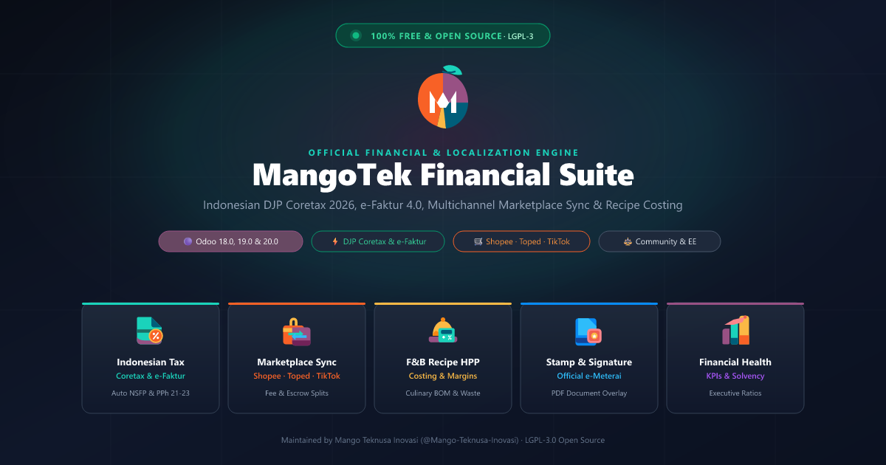

<div align="center">



# MangoTek Financial Suite

[](LICENSE)
[](#)
[](https://www.odoo.com/)
[](#)
[](BRANDKIT.md)
[](https://github.com/Mango-Teknusa-Inovasi)

**Enterprise-Ready Financial Engine, Indonesian Tax Localization (DJP Coretax 2026), Multi-Marketplace Settlement & Recipe Costing for Odoo 18.0, 19.0 & 20.0.**

[Overview](#-overview) • [Core Modules](#-core-modules) • [Brandkit](#-brand-identity--design-tokens) • [Installation](#-getting-started) • [Guidelines](#-repository-layout) • [License](#-license)

</div>

---

## 🌟 Overview

Standard ERP systems introduce significant administrative overhead when applied to Indonesian fiscal landscapes, multi-platform e-commerce reconciliation, and agile F&B costing. 

**MangoTek Financial Suite** delivers a modular, zero-bloat, open-source financial foundation designed natively for Odoo. Every module follows Odoo's native ORM, view architecture, and geometric vector iconography standards.

> [!NOTE]
> **100% Free & Open Source:** This entire suite is released under the **GNU Lesser General Public License v3.0 (LGPL-3.0)**. It is free to use, deploy, and customize on both **Odoo Community** and **Odoo Enterprise** without licensing fees, subscriptions, or activation locks.

---

## 🧩 Core Modules

| Module Icon | Module Directory | Display Name | Statutory / Operational Scope |
|:---:|:---|:---|:---|
|  | [`l10n_id_coretax_taxation`](l10n_id_coretax_taxation) | **Indonesian Tax Coretax** | • DJP Coretax 2026 & e-Faktur 4.0 batch CSV export<br>• Automated NSFP (Nomor Seri Faktur Pajak) sequential pool<br>• 16-Digit NIK/NPWP16 & 22-Digit NITKU validation<br>• PPh 21, 22, 23, 4(2), and PPh Final UMKM 0.5% (PP 20/2026) |
|  | [`marketplace_settlement_sync`](marketplace_settlement_sync) | **Marketplace Settlement** | • Multi-channel statement parser (Shopee, Tokopedia, TikTok Shop)<br>• Automated split-accounting: Gross Revenue vs Platform Fees vs Escrow Payouts<br>• Single-click draft journal entry generation and audit trail drilldown |
|  | [`fnb_hpp_calculator`](fnb_hpp_calculator) | **F&B Recipe HPP** | • Lightweight culinary & retail bill of materials (BOM)<br>• Real-time ingredient costing, wastage factor adjustments, and gross margin tracking<br>• Interactive price & margin simulator wizard |
|  | [`account_stamp_signature`](account_stamp_signature) | **Stamp & e-Meterai** | • Dual-engine document seal: Transparent PNG company stamp overlay (-6° tilt) + digital signature<br>• Pluggable Peruri e-Meterai Gateway (UU No. 10/2020) for invoices >= Rp 5.000.000<br>• Local Sandbox mock simulator + BYOK API connectors (PDS, Mekari Sign, PrivyID) |
|  | `financial_health_dashboard` *(Phase 5)* | **Financial Health KPI** | • Executive financial ratios (Current Ratio, Quick Ratio, Debt-to-Equity, Net Margin) with visual health badges |

---

## 🎨 Brand Identity & Design Tokens

The suite follows an official design language harmonized with Odoo's native geometric vector palette. For complete color tokens, geometry construction grids, SVG specifications, and anti-slop rules, consult:

👉 **[MangoTek Financial Suite — Brand Identity Kit (BRANDKIT.md)](BRANDKIT.md)**

```
Odoo Aubergine (#985184)  ·  Fiscal Mint (#1AD3BB)  ·  Mango Tangerine (#F86126)
Sunflower Gold (#FBB945)  ·  Royal Azure (#088BF5)  ·  Deep Slate Petrol (#005E7A)
```

---

## 📂 Repository Layout

```text
odoo-financial-suite/
├── assets/
│   ├── banner.png                   # High-resolution 1280x640 repo hero banner
│   ├── banner.svg                   # Vector source banner
│   └── icons/                       # SVG and PNG renders (100px, 512px, 1024px)
├── l10n_id_coretax_taxation/         # Indonesian taxation & DJP Coretax engine
├── marketplace_settlement_sync/      # Omnichannel settlement reconciliation
├── sample_app/                       # Verified Odoo 18/20 testing scaffold
├── BRANDKIT.md                       # Comprehensive design system & brand guidelines
├── CHANGELOG.md                      # Release notes & version milestones
├── CONTRIBUTING.md                   # Contribution workflow & commit standards
├── CODE_OF_CONDUCT.md                # Community covenant
├── SECURITY.md                       # Vulnerability reporting & security policy
├── CITATION.bib                      # Academic and technical citation metadata
└── ROADMAP.md                        # Strategic multi-phase engineering roadmap
```

---

## 🚀 Getting Started

### Prerequisites
* **Odoo:** Version `18.0`, `19.0`, or `20.0` (Community or Enterprise)
* **Python:** `3.10` or higher
* **Database:** PostgreSQL `14+`

### Installation

1. **Clone this repository** into your custom addons directory:
   ```bash
   git clone https://github.com/Mango-Teknusa-Inovasi/odoo-financial-suite.git
   ```

2. **Add to your Odoo configuration file (`odoo.conf`)**:
   ```ini
   addons_path = /opt/odoo/odoo/addons,/opt/odoo/custom-addons/odoo-financial-suite
   ```

3. **Update Odoo apps database**:
   ```bash
   python3 odoo-bin -c /etc/odoo/odoo.conf -u base --stop-after-init
   ```

4. **Activate in Odoo Web Client**:
   * Open **Settings** > Activate **Developer Mode**.
   * Navigate to the **Apps** menu.
   * Click **Update Apps List** in the top navigation bar.
   * Search for `Indonesian Tax Coretax` or `Marketplace Settlement` and click **Activate**.

---

## 👥 Authors & Maintainers

* **Mango Teknusa Inovasi** ([@Mango-Teknusa-Inovasi](https://github.com/Mango-Teknusa-Inovasi))
* **Support & Security Desk:** `billing@ppti.me`

---

## 📄 License

This software suite is published under the **GNU Lesser General Public License v3.0 (LGPL-3.0)**.  
See the full text in [LICENSE](LICENSE).
