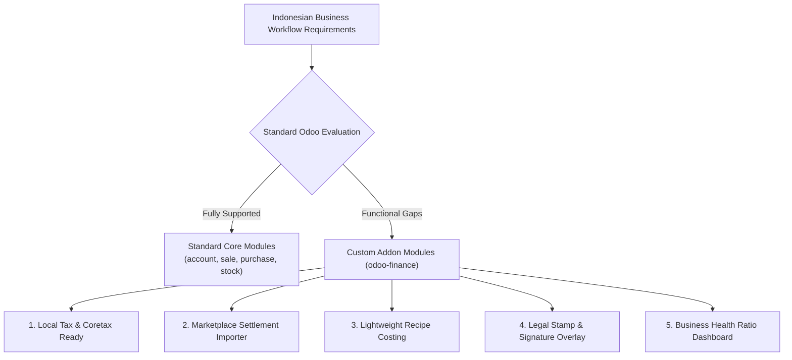
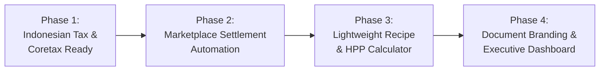

# 🗺️ Odoo Financial Suite Roadmap & Architecture Specification
## *Functional Gap Analysis and Development Roadmap for Indonesian Business Localization*

---

> [!NOTE]
> **Confidentiality & Intellectual Property Disclaimer:**
> This document serves exclusively as an architectural and functional gap analysis. All proprietary trademarks, product names, and proprietary codebase references from the evaluated external software are anonymized as **"Reference Financial System"**. Implementation within Odoo is authored 100% using original code adhering to official Odoo framework standards (Python, XML, ORM, QWeb).

---

## 1. Executive Summary & Gap Analysis

The Reference Financial System was custom-engineered to solve the real-world operational and regulatory frictions faced by Indonesian businesses (MSMEs, retail, F&B, and multichannel online merchants)—areas where standard international ERPs typically lack out-of-the-box local compliance and simplified workflows.

### Functional Gap Matrix

| Functional Domain | Standard Odoo Status | Indonesian Business Localization Requirement | Priority |
| :--- | :--- | :--- | :---: |
| **Chart of Accounts & GL** | Complete (`account`) | Standard Indonesian Chart of Accounts (COA). | Low (Standard) |
| **Invoicing & Purchasing** | Complete (`sale`, `purchase`) | Core document workflows are sufficient. | Low (Standard) |
| **Withholding Tax & Coretax** | **Limited (VAT only)** | Comprehensive PPh (21/22/23/4(2)/Final MSME), NITKU & Coretax export. | **Critical (Phase 1)** |
| **Marketplace Reconciliation** | **Unavailable** | Automated Excel settlement parsers for Shopee, TikTok Shop, Tokopedia. | **High (Phase 2)** |
| **Recipe Costing & HPP** | **Over-engineered (`mrp`)** | Agile, non-SKU portion costing without heavy manufacturing orders. | **High (Phase 3)** |
| **Legal Document PDF** | **Basic plain signatures** | Auto-overlay transparent company seal over digital signatures. | Medium (Phase 4) |
| **Financial Health Analytics** | **Static financial reports** | Visual educational health ratios (Liquidity, Solvency, Margin) with status badges. | Medium (Phase 4) |

---

## 2. Phased Development Roadmap

---

### 📌 Phase 1: Indonesian Taxation & Coretax Compliance (`l10n_id_coretax_taxation`)
> **Goal:** Ensure all commercial sales and vendor bills automatically calculate, record, and summarize Indonesian withholding taxes aligned with DJP Coretax specifications and Government Regulation PP 20/2026.

#### Key Tasks:
1. **Partner Extension (`res.partner`):**
   * Standardize **16-digit NPWP** field with input format validation.
   * Add **NITKU (Nomor Induk Tempat Kegiatan Usaha)** 22-digit field.
   * Taxpayer categorization: Corporate (*Badan*), Individual (*Orang Pribadi*), or Tax Exemption Facility (*SKB*).
2. **Withholding Tax Structure:**
   * Tax accounts and rates for **PPh 23** (Services 2%, Rental 2%), **PPh 4(2)** (Real estate rental 10%, Construction), and **PPh 22**.
   * **MSME Final Income Tax 0.5% (PP 20/2026):**
     * Automated gross turnover calculation before discounts.
     * Annual cumulative threshold tracker for the IDR 500,000,000 non-taxable turnover bracket for individual entrepreneurs.
     * Toggle for "Self-Remitted" (*Disetor Sendiri*) vs. "Withheld by Counterparty" (*Dipotong Lawan Transaksi*).
3. **Withholding Tax Slips & Codes:**
   * Fields for Tax Withholding Slip Number (*Nomor Bukti Potong*) and Tax Object Code (*Kode Objek Pajak*) directly on vendor bills and customer invoices.
4. **Coretax Export Wizard:**
   * Monthly tax summary report with single-click CSV/Excel export pre-formatted for direct upload into the DJP Coretax web portal.

---

### 📌 Phase 2: Multichannel Marketplace Settlement Sync (`marketplace_settlement_sync`)
> **Goal:** Eliminate manual entry of e-commerce settlement reports by parsing raw export files from Indonesian marketplaces directly into balanced, reconciled journal entries.

#### Key Tasks:
1. **Multi-Platform Excel Parser Wizard:**
   * Dedicated file parsers (`.xlsx` / `.csv`) for major Indonesian e-commerce platforms:
     * **Platform S:** Paid Order and Seller Balance settlement reports.
     * **Platform T:** Order Completion and Daily GMV transaction analytics.
2. **Automated Split-Accounting Logic:**
   * Daily aggregation: Consolidate hundreds of sub-orders into single daily summary entries to prevent database bloating.
   * **Debit:** Marketplace Escrow / Clearing Account (Asset).
   * **Credit:** Sales Turnover Account (4100 Pendapatan Penjualan).
   * **Debit Expenses:** Automatically extract platform service fees, free-shipping campaign deductions, and payment gateway commissions into *Marketplace Administration Expenses (6150)*.
3. **Reconciliation Verification Preview:**
   * Interactive modal window showing transaction net balance and fee reconciliation breakdown before committing to the general ledger.

---

### 📌 Phase 3: Lightweight Recipe & HPP Costing Engine (`fnb_hpp_calculator`)
> **Goal:** Provide an intuitive, instant recipe costing system for F&B, café, bakery, and light assembly businesses without the administrative burden of Odoo's Manufacturing (`mrp`) module.

#### Key Tasks:
1. **Raw Material & Measurement Conversion:**
   * Purchase unit pricing in wholesale quantities (kg, liter, pack, box).
   * Automatic conversion into portion-level recipe measurements (grams, milliliters, pieces, drops).
2. **Recipe Costing Card Model:**
   * Formulation model defining menu items and their ingredient breakdown.
   * Dynamic real-time calculation:
     $$\text{Base Cost (HPP)} = \sum (\text{Portion Quantity} \times \text{Ingredient Unit Price}) + \text{Packaging/Overhead Allocation}$$
   * Instant Gross Profit Margin percentage based on proposed retail menu prices.
3. **Cost Sensitivity & Price Shift Alerts:**
   * When raw material purchase costs fluctuate via vendor bills, the system recalculates portion cost and flags items where margin drops below the target threshold.

---

### 📌 Phase 4: Official Document Branding & Financial Analytics (`business_document_dashboard`)
> **Goal:** Elevate company branding on PDF invoices and provide executive business health indicators in an accessible format for business owners.

#### Key Tasks:
1. **Automated Stamp & Signature Overlay:**
   * Company settings configuration (`res.company`) for digital signature and company seal (PNG with transparency).
   * Custom QWeb PDF report templates: Precise CSS layout overlaying the semi-transparent legal stamp over the digital signature, replicating authentic Indonesian formal documentation.
2. **Executive Financial Health Dashboard:**
   * Automated key metric computations:
     * **Liquidity:** Current Ratio, Quick Ratio, Cash Ratio.
     * **Solvency:** Debt-to-Equity Ratio (DER).
     * **Profitability:** Gross Profit Margin, Net Profit Margin (NPM), Return on Equity (ROE).
   * Traffic-light health status cards:
     * 🟢 **Healthy:** Exceeds safe industry benchmark.
     * 🟡 **Adequate:** Borderline cash reserve / operational efficiency.
     * 🔴 **Action Required:** Solvency risk or negative operating margin.
   * Concise educational tooltips describing the underlying accounting formula.

---

## 3. Implementation Matrix & Technical Effort

| Phase | Technical Module Name | Estimated Effort | Complexity | Key Deliverable |
| :---: | :--- | :---: | :---: | :--- |
| **1** | `l10n_id_coretax_taxation` | 1-2 Days | Medium | NPWP/NITKU, Auto PPh withholding, Coretax export |
| **2** | `marketplace_settlement_sync` | 2-3 Days | Med-High | Excel import wizard, split-entry automation |
| **3** | `fnb_hpp_calculator` | 1-2 Days | Medium | Recipe card costing, live margin simulation |
| **4** | `account_stamp_signature` | 1 Day | Low | QWeb PDF stamp overlay for Invoice & PO |
| **5** | `financial_health_dashboard` | 1-2 Days | Medium | Interactive executive ratio widget & status badges |

---

## 4. Odoo Architectural & Coding Standards

All suite plugins strictly follow modern Odoo framework standards:
1. **Clean Model Inheritance:** Utilize `_inherit` to extend standard models (`res.partner`, `account.move`, `account.tax`) without monkey-patching or altering core code.
2. **Granular Access Security:** Enforce role-based access rules via `ir.model.access.csv` and domain-specific `ir.rule` definitions for User and Administrator tiers.
3. **General Ledger Integrity:** Ensure all automated entries maintain balanced debit and credit invariants adhering to double-entry bookkeeping.
