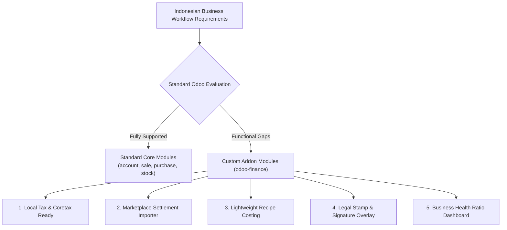
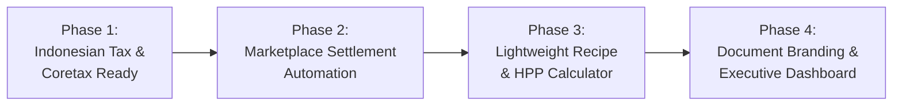

# 🗺️ Odoo Financial Suite Roadmap & Architecture Specification
## *Functional Gap Analysis and Development Roadmap for Indonesian Business Localization*

---

> [!NOTE]
> **Confidentiality & Intellectual Property Disclaimer:**
> This document serves exclusively as an architectural and functional gap analysis. All proprietary trademarks, product names, and proprietary codebase references from the evaluated external software are anonymized as **"Reference Financial System"**. Implementation within Odoo is authored 100% using original code adhering to official Odoo framework standards (Python, XML, ORM, QWeb).

---

## 1. Executive Summary & Gap Analysis

The Reference Financial System was custom-engineered to solve the real-world operational and regulatory frictions faced by Indonesian businesses (MSMEs, retail, F&B, and multichannel online merchants)—areas where standard international ERPs typically lack out-of-the-box local compliance and simplified workflows.

### Functional Gap Matrix

| Functional Domain | Standard Odoo Status | Indonesian Business Localization Requirement | Priority / Status |
| :--- | :--- | :--- | :---: |
| **Chart of Accounts & GL** | Complete (`account`) | Standard Indonesian Chart of Accounts (COA). | Complete (Core) |
| **Invoicing & Purchasing** | Complete (`sale`, `purchase`) | Core document workflows are sufficient. | Complete (Core) |
| **Withholding Tax & Coretax** | **Limited (VAT only)** | Comprehensive PPh (21/22/23/4(2)/Final MSME), NITKU, NSFP Pool & Coretax export. | **✅ Done (Phase 1)** |
| **Marketplace Reconciliation** | **Unavailable** | Automated Excel settlement parsers for Shopee, TikTok Shop, Tokopedia. | **✅ Done (Phase 2)** |
| **Recipe Costing & HPP** | **Over-engineered (`mrp`)** | Agile, portion costing with waste/shrinkage factor without heavy manufacturing. | **✅ Done (Phase 3)** |
| **Legal Document PDF** | **Basic plain signatures** | Auto-overlay transparent company seal over digital signatures. | 🚀 **Up Next (Phase 4)** |
| **Financial Health Analytics** | **Static financial reports** | Visual educational health ratios (Liquidity, Solvency, Margin) with status badges. | 🚀 **Up Next (Phase 4)** |

---

## 2. Phased Development Roadmap

---

### 📌 Phase 1: Indonesian Taxation & Coretax Compliance (`l10n_id_coretax_taxation`) — ✅ COMPLETED
> **Goal:** Ensure all commercial sales and vendor bills automatically calculate, record, and summarize Indonesian withholding taxes aligned with DJP Coretax specifications and Government Regulation PP 20/2026.

#### Implementation Summary:
* [x] **NPWP & NITKU Validation:** 16-digit NIK/NPWP16 and 22-digit NITKU validation on `res.partner`.
* [x] **DJP Coretax Tax Structure:** PPN 12% (UU HPP), PPh 21, 22, 23, 4(2), and PPh Final UMKM 0.5% (PP 20/2026).
* [x] **Automated NSFP Allocation:** Sequential NSFP pool range management (`l10n_id.nsfp.range`) assigned automatically upon posting customer invoices.
* [x] **e-Faktur 4.0 & Coretax CSV Batch Exporter:** Multi-invoice export wizards generating statutory `FK` and `OF` CSV data for the DJP Coretax web portal.
* [x] **Live Testing:** Verified on `INV/2026/00002` with NSFP `01.000-26.10000001` for demo company *MangoTek Development Center*.

---

### 📌 Phase 2: Multichannel Marketplace Settlement Sync (`marketplace_settlement_sync`) — ✅ COMPLETED
> **Goal:** Eliminate manual entry of e-commerce settlement reports by parsing raw export files from Indonesian marketplaces directly into balanced, reconciled journal entries.

#### Implementation Summary:
* [x] **Omnichannel Channel Configuration:** Preset accounts for Shopee, Tokopedia, TikTok Shop, Blibli, and custom channels.
* [x] **Split-Accounting Engine:** Automatically divides Gross Order Value, Platform Deductions (Commission, Shipping, Vouchers), and Net Escrow Deposits into dedicated ledger accounts.
* [x] **1-Click Draft Journal Creation:** Ingest settlement batches and generate draft entries into General Journal with order-level line item drilldown.
* [x] **Live Verification:** Tested and reconciled batch `SETTLE/2026/00001` with Shopee Indonesia.

---

### 📌 Phase 3: Lightweight Recipe & HPP Costing Engine (`fnb_hpp_calculator`) — ✅ COMPLETED
> **Goal:** Provide an intuitive, instant recipe costing system for F&B, café, bakery, and light assembly businesses without the administrative burden of Odoo's Manufacturing (`mrp`) module.

#### Implementation Summary:
* [x] **Portion Unit Economics:** Real-time conversion of bulk purchase raw materials to recipe portion measurements (g, ml, pcs).
* [x] **Waste / Shrinkage Factor (%):** Trimming, peeling, and cooking loss factor automatically adjusts effective ingredient cost.
* [x] **Packaging Allocation Layer:** Dedicated lines for cups, lids, straws, clamshell boxes, and takeaway packaging.
* [x] **Visual Margin Health Badges:** Color-coded status flags for Optimal ($\ge 65\%$), Moderate ($50\%-64\%$), and Low/Underpriced ($< 50\%$).
* [x] **Menu Price & Margin Simulator:** Forward and reverse calculation wizard to determine retail prices for desired profit margins.
* [x] **1-Click POS Product Sync:** Push calculated HPP standard costs and selling prices directly to linked catalog products.
* [x] **Live Verification:** Tested with *Iced Caramel Macchiato 16oz* (HPP Rp 12,712, Margin 66.5% - Optimal) and *Gourmet Wagyu Burger* (HPP Rp 46,332, Margin 31.9% - Low Margin Warning).

---

### 📌 Phase 4: Official Document Branding & Financial Analytics (`account_stamp_signature` & `financial_health_dashboard`) — 🚀 UP NEXT
> **Goal:** Elevate company branding on PDF invoices and provide executive business health indicators in an accessible format for business owners.

#### Key Tasks:
1. **Automated Stamp & Signature Overlay:**
   * Company settings configuration (`res.company`) for digital signature and company seal (PNG with transparency).
   * Custom QWeb PDF report templates: Precise CSS layout overlaying the semi-transparent legal stamp over the digital signature, replicating authentic Indonesian formal documentation.
2. **Executive Financial Health Dashboard:**
   * Automated key metric computations:
     * **Liquidity:** Current Ratio, Quick Ratio, Cash Ratio.
     * **Solvency:** Debt-to-Equity Ratio (DER).
     * **Profitability:** Gross Profit Margin, Net Profit Margin (NPM), Return on Equity (ROE).
   * Traffic-light health status cards:
     * 🟢 **Healthy:** Exceeds safe industry benchmark.
     * 🟡 **Adequate:** Borderline cash reserve / operational efficiency.
     * 🔴 **Action Required:** Solvency risk or negative operating margin.
   * Concise educational tooltips describing the underlying accounting formula.

---

## 3. Implementation Matrix & Technical Effort

| Phase | Technical Module Name | Estimated Effort | Complexity | Key Deliverable |
| :---: | :--- | :---: | :---: | :--- |
| **1** | `l10n_id_coretax_taxation` | 1-2 Days | Medium | NPWP/NITKU, Auto PPh withholding, Coretax export |
| **2** | `marketplace_settlement_sync` | 2-3 Days | Med-High | Excel import wizard, split-entry automation |
| **3** | `fnb_hpp_calculator` | 1-2 Days | Medium | Recipe card costing, live margin simulation |
| **4** | `account_stamp_signature` | 1 Day | Low | QWeb PDF stamp overlay for Invoice & PO |
| **5** | `financial_health_dashboard` | 1-2 Days | Medium | Interactive executive ratio widget & status badges |

---

## 4. Odoo Architectural & Coding Standards

All suite plugins strictly follow modern Odoo framework standards:
1. **Clean Model Inheritance:** Utilize `_inherit` to extend standard models (`res.partner`, `account.move`, `account.tax`) without monkey-patching or altering core code.
2. **Granular Access Security:** Enforce role-based access rules via `ir.model.access.csv` and domain-specific `ir.rule` definitions for User and Administrator tiers.
3. **General Ledger Integrity:** Ensure all automated entries maintain balanced debit and credit invariants adhering to double-entry bookkeeping.
