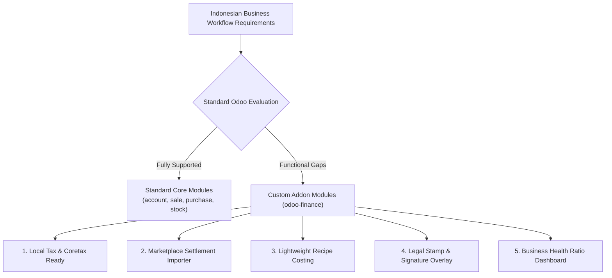
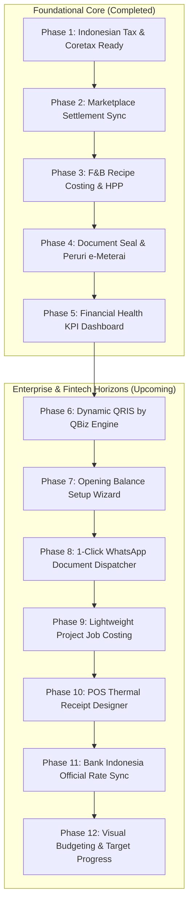

# 🗺️ Odoo Financial Suite Roadmap & Architecture Specification
## *Functional Gap Analysis and Development Roadmap for Indonesian Business Localization*

---

> [!NOTE]
> **Confidentiality & Intellectual Property Disclaimer:**
> This document serves exclusively as an architectural and functional gap analysis. All proprietary trademarks, product names, and proprietary codebase references from the evaluated external software are anonymized as **"Reference Financial System"**. Implementation within Odoo is authored 100% using original code adhering to official Odoo framework standards (Python, XML, ORM, QWeb).

---

## 1. Executive Summary & Gap Analysis

The Reference Financial System was custom-engineered to solve the real-world operational and regulatory frictions faced by Indonesian businesses (MSMEs, retail, F&B, and multichannel online merchants)—areas where standard international ERPs typically lack out-of-the-box local compliance and simplified workflows.

### Functional Gap Matrix

| Functional Domain | Standard Odoo Status | Indonesian Business Localization Requirement | Priority / Status |
| :--- | :--- | :--- | :---: |
| **Chart of Accounts & GL** | Complete (`account`) | Standard Indonesian Chart of Accounts (COA). | Complete (Core) |
| **Invoicing & Purchasing** | Complete (`sale`, `purchase`) | Core document workflows are sufficient. | Complete (Core) |
| **Withholding Tax & Coretax** | **Limited (VAT only)** | Comprehensive PPh (21/22/23/4(2)/Final MSME), NITKU, NSFP Pool & Coretax export. | **✅ Done (Phase 1)** |
| **Marketplace Reconciliation** | **Unavailable** | Automated Excel settlement parsers for Shopee, TikTok Shop, Tokopedia. | **✅ Done (Phase 2)** |
| **Recipe Costing & HPP** | **Over-engineered (`mrp`)** | Agile, portion costing with waste/shrinkage factor without heavy manufacturing. | **✅ Done (Phase 3)** |
| **Legal Document Seal & e-Meterai** | **Basic plain signatures** | Dual-engine transparent wet stamp overlay (-6° tilt) + Peruri e-Meterai Gateway (UU 10/2020). | **✅ Done (Phase 4)** |
| **Financial Health Analytics** | **Static financial reports** | Visual educational health ratios (Liquidity, Solvency, Margin) with status badges. | **✅ Done (Phase 5)** |

---

## 2. Phased Development Roadmap

---

### 📌 Phase 1: Indonesian Taxation & Coretax Compliance (`l10n_id_coretax_taxation`) — ✅ COMPLETED
> **Goal:** Ensure all commercial sales and vendor bills automatically calculate, record, and summarize Indonesian withholding taxes aligned with DJP Coretax specifications and Government Regulation PP 20/2026.

#### Implementation Summary:
* [x] **NPWP & NITKU Validation:** 16-digit NIK/NPWP16 and 22-digit NITKU validation on `res.partner`.
* [x] **DJP Coretax Tax Structure:** PPN 12% (UU HPP), PPh 21, 22, 23, 4(2), and PPh Final UMKM 0.5% (PP 20/2026).
* [x] **Automated NSFP Allocation:** Sequential NSFP pool range management (`l10n_id.nsfp.range`) assigned automatically upon posting customer invoices.
* [x] **e-Faktur 4.0 & Coretax CSV Batch Exporter:** Multi-invoice export wizards generating statutory `FK` and `OF` CSV data for the DJP Coretax web portal.
* [x] **Live Testing:** Verified on `INV/2026/00002` with NSFP `01.000-26.10000001` for demo company *MangoTek Development Center*.

---

### 📌 Phase 2: Multichannel Marketplace Settlement Sync (`marketplace_settlement_sync`) — ✅ COMPLETED
> **Goal:** Eliminate manual entry of e-commerce settlement reports by parsing raw export files from Indonesian marketplaces directly into balanced, reconciled journal entries.

#### Implementation Summary:
* [x] **Omnichannel Channel Configuration:** Preset accounts for Shopee, Tokopedia, TikTok Shop, Blibli, and custom channels.
* [x] **Split-Accounting Engine:** Automatically divides Gross Order Value, Platform Deductions (Commission, Shipping, Vouchers), and Net Escrow Deposits into dedicated ledger accounts.
* [x] **1-Click Draft Journal Creation:** Ingest settlement batches and generate draft entries into General Journal with order-level line item drilldown.
* [x] **Live Verification:** Tested and reconciled batch `SETTLE/2026/00001` with Shopee Indonesia.

---

### 📌 Phase 3: Lightweight Recipe & HPP Costing Engine (`fnb_hpp_calculator`) — ✅ COMPLETED
> **Goal:** Provide an intuitive, instant recipe costing system for F&B, café, bakery, and light assembly businesses without the administrative burden of Odoo's Manufacturing (`mrp`) module.

#### Implementation Summary:
* [x] **Portion Unit Economics:** Real-time conversion of bulk purchase raw materials to recipe portion measurements (g, ml, pcs).
* [x] **Waste / Shrinkage Factor (%):** Trimming, peeling, and cooking loss factor automatically adjusts effective ingredient cost.
* [x] **Packaging Allocation Layer:** Dedicated lines for cups, lids, straws, clamshell boxes, and takeaway packaging.
* [x] **Visual Margin Health Badges:** Color-coded status flags for Optimal ($\ge 65\%$), Moderate ($50\%-64\%$), and Low/Underpriced ($< 50\%$).
* [x] **Menu Price & Margin Simulator:** Forward and reverse calculation wizard to determine retail prices for desired profit margins.
* [x] **1-Click POS Product Sync:** Push calculated HPP standard costs and selling prices directly to linked catalog products.
* [x] **Live Verification:** Tested with *Iced Caramel Macchiato 16oz* (HPP Rp 12,712, Margin 66.5% - Optimal) and *Gourmet Wagyu Burger* (HPP Rp 46,332, Margin 31.9% - Low Margin Warning).

---

### 📌 Phase 4: Dual-Engine Document Seal, Signature & Peruri e-Meterai Gateway (`account_stamp_signature`) — ✅ COMPLETED
> **Goal:** Deliver a bifurcated document legal branding and statutory compliance system catering to both free internal documents and official e-Meterai duty under Indonesian law (UU No. 10/2020).

#### Implementation Summary:
* [x] **Engine A (100% Free & Offline):** Transparent PNG wet seal overlay with dynamic $-6^\circ$ tilt and $82\%$ opacity overlapping digital signature canvas in QWeb PDF invoice.
* [x] **Company Settings (`res.company`):** Fields for seal graphic, authorized executive signature, signatory name, and official designation.
* [x] **Engine B (Statutory e-Meterai):** Automatic threshold detection flagging invoices $\ge \text{Rp } 5.000.000$ for statutory Bea Meterai duty (Rp 10.000).
* [x] **Pluggable Provider Architecture:** Driver pattern supporting Peruri Digital Security (PDS), Mekari Sign, PrivyID, and built-in Local Sandbox Simulator (100 test stamps).
* [x] **Peruri Serial Number & QR Code:** Generates 22-digit Peruri SN (`SN-2026-82317851986049`) and public verification URL.
* [x] **QWeb PDF Report Integration:** Renders official Peruri bordered rosette emblem and barcode alongside the wet seal on `account.report_invoice_document`.
* [x] **Live Verification:** Tested and certified on invoice `INV/2026/00002` (Rp 54,028,500.00) in Docker container `odoo18_web`.

---

### 📌 Phase 5: Executive Financial Health KPI Dashboard (`financial_health_kpi`) — ✅ COMPLETED
> **Goal:** Deliver executive-level financial ratio KPI widgets (Liquidity, Solvency, Margin health indicators) with educational tooltips, visual status cards, and plain-language advisory insights.

#### Implementation Summary:
* [x] **Automated Key Financial Ratios:**
  * **Liquidity:** Current Ratio (2.08x - Optimal), Quick Ratio (1.93x - Optimal), Cash Ratio (0.00x - Warning).
  * **Solvency:** Debt-to-Equity Ratio (0.93x - Optimal), Debt-to-Asset Ratio (0.48x - Moderate).
  * **Profitability:** Gross Profit Margin (52.0% - Optimal), Net Profit Margin (51.7% - Optimal).
  * **Working Capital:** Net Working Capital computation (Rp 66,950,500.00 surplus).
* [x] **Educational Traffic-Light System:**
  * 🟢 **Optimal:** Exceeds safe industry benchmark.
  * 🟡 **Moderate:** Borderline reserve or delayed receivables.
  * 🔴 **Critical:** High leverage or liquidity squeeze warning.
* [x] **Automated Executive Advisory Synthesis:** Plain-language analytical diagnostic highlighting strengths and flagging receivables collection risks.
* [x] **Interactive Dashboard & Ledger Drilldown:** Kanban dashboard card with health score (96/100) and 1-click drilldowns into Trade Receivables, Payables, and General Ledger.
* [x] **Live Verification:** Tested and evaluated live on *MangoTek Development Center* in Docker container `odoo18_web`.

---

### 📌 Phase 6: Dynamic QRIS Invoicing & POS (`account_qris_qbiz`) — 🚀 UPCOMING TARGET
> **Goal:** Integrate dynamic QRIS payments into customer invoices, web portal, and POS terminals, powered by the open-source engine of [ardianryan/qbiz-qrisdinamis](https://github.com/ardianryan/qbiz-qrisdinamis).
* [ ] **Dual-Engine Architecture:**
  * **Mode A (Standalone Local Engine):** Native EMVCo TLV parser/serializer injecting Tag 54 (Transaction Amount) and recalculating CRC16 checksum directly in pure Python (0 external dependencies).
  * **Mode B (QBiz Middleware Connector):** REST API integration (`POST /api/v1/invoices`) generating unique 3-digit anti-collision suffixes (e.g., Rp 50,002).
* [ ] **Webhook Auto-Reconciliation:** Controller at `/api/v1/webhook/qris` receiving payment confirmation from QBiz and instantly registering payment to mark invoice `paid`.
* [ ] **QWeb PDF & POS Presentation:** Scannable 2D barcode block with payment instructions on PDF invoices and POS receipt.

---

### 📌 Phase 7: Opening Balance Setup Wizard (`account_opening_balance_wizard`) — 📋 PLANNED
> **Goal:** Eliminate confusion during new business onboarding with a streamlined, 1-page financial balance setup wizard.
* [ ] **Cash & Bank Activation:** Quick saldo card input with 1-click bank account activation toggle.
* [ ] **Historical Partner Breakdown:** Tabular input for historical receivables (AR) and payables (AP) with due dates, automatically establishing individual tracking cards.
* [ ] **Fixed Assets & Auto-Amortization:** Input asset cost, acquisition date, and useful life with automated future monthly depreciation scheduling.
* [ ] **Automatic Equity Balancing:** Real-time formula balancing `Total Assets - Total Liabilities` directly into Equity (3100 Owner's Capital), eliminating suspense account confusion.

---

### 📌 Phase 8: 1-Click WhatsApp Document Dispatcher (`account_whatsapp_notifier`) — 📋 PLANNED
> **Goal:** Send invoices, bills, purchase orders, and delivery slips directly to customer/vendor WhatsApp numbers.
* [ ] **One-Click WhatsApp Action:** Smart button on `account.move` and `sale.order` opening pre-filled WhatsApp message.
* [ ] **Dual Gateway Support:** WhatsApp Web click-to-chat URL link + direct API connector (WhatsApp Cloud API / local gateways like Fonnte/Wablas).
* [ ] **Dynamic Document Link:** Generates secure tokenized PDF download links for buyers.

---

### 📌 Phase 9: Lightweight Project Job Costing (`account_project_job_costing`) — 📋 PLANNED
> **Goal:** Provide agile profit & loss tracking per project without requiring Odoo's complex Analytic Accounting structure.
* [ ] **Tagging Architecture:** Lightweight project tag dropdown on sales invoices, vendor bills, and operational expenses.
* [ ] **Dual-Metric Realtime Dashboard:**
  * **Accrual Profit:** Actual revenue minus direct COGS and project expenses.
  * **Cash Position:** Visual alert separating uncollected customer receivables from unpaid vendor bills.
* [ ] **Project Lifecycle:** Track status (`Draft`, `In Progress`, `Completed`) with closure audit checks.

---

### 📌 Phase 10: Visual POS Thermal Receipt Designer (`pos_thermal_receipt_designer`) — 📋 PLANNED
> **Goal:** Provide a no-code visual designer for POS receipt printing on Bluetooth thermal printers.
* [ ] **Dual Width Presets:** One-click layout switching between **58 mm** (portable belt printers) and **80 mm** (desktop counter printers).
* [ ] **Live Monochrome Preview:** Real-time paper preview while typing headers, footers, return policies, or social media handles.
* [ ] **Logo & QRIS Placement:** Automatic 1-bit monochrome dithering for store logos and dynamic QR codes.

---

### 📌 Phase 11: Bank Indonesia Official Rate Sync (`l10n_id_bi_currency_rate`) — 📋 PLANNED
> **Goal:** Automate daily foreign exchange rate updates directly from official Bank Indonesia (JISDOR / Kurs Transaksi BI) data.
* [ ] **Automated Daily Cron:** Scheduled task fetching official BI rates for USD, EUR, SGD, JPY, CNY, and MYR.
* [ ] **Multi-Currency Pricing:** Automatic conversion for international transactions adhering to statutory Indonesian customs & tax regulations.

---

### 📌 Phase 12: Visual Budgeting & Target Progress (`account_simple_budgeting`) — 📋 PLANNED
> **Goal:** Empower business owners to set monthly revenue targets and expense ceilings with real-time visual progress indicators.
* [ ] **Target vs Actual Tracking:** Set monthly targets per COA account with variance percentage analysis.
* [ ] **Traffic-Light Progress Gauges:** Visual color-coded progress bars (🟢 Within Budget, 🟡 Near Limit, 🔴 Over Budget).

---

## 3. Implementation Matrix & Technical Effort

| Phase | Technical Module Name | Estimated Effort | Complexity | Key Deliverable | Status |
| :---: | :--- | :---: | :---: | :--- | :---: |
| **1** | `l10n_id_coretax_taxation` | 1-2 Days | Medium | NPWP/NITKU, Auto PPh withholding, Coretax export | **✅ Completed** |
| **2** | `marketplace_settlement_sync` | 2-3 Days | Med-High | Excel import wizard, split-entry automation | **✅ Completed** |
| **3** | `fnb_hpp_calculator` | 1-2 Days | Medium | Recipe card costing, live margin simulation | **✅ Completed** |
| **4** | `account_stamp_signature` | 1 Day | Low | QWeb PDF stamp overlay & Peruri e-Meterai gateway | **✅ Completed** |
| **5** | `financial_health_kpi` | 1-2 Days | Medium | Interactive executive ratio widget & status badges | **✅ Completed** |
| **6** | `account_qris_qbiz` | 1-2 Days | Medium | Dynamic QRIS (QBiz engine), auto-reconciliation webhook | **🚀 Ready to Build** |
| **7** | `account_opening_balance_wizard` | 1-2 Days | Low-Med | 1-page onboarding wizard, auto-balance to equity | **📋 Planned** |
| **8** | `account_whatsapp_notifier` | 1 Day | Low | 1-click WhatsApp document dispatch & PDF link | **📋 Planned** |
| **9** | `account_project_job_costing` | 1-2 Days | Medium | Tagging job costing, dual-metric cashflow dashboard | **📋 Planned** |
| **10** | `pos_thermal_receipt_designer` | 1-2 Days | Low-Med | Visual 58mm/80mm thermal receipt designer & live preview | **📋 Planned** |
| **11** | `l10n_id_bi_currency_rate` | 1 Day | Low | Daily Bank Indonesia JISDOR official rate auto-sync | **📋 Planned** |
| **12** | `account_simple_budgeting` | 1 Day | Low-Med | Monthly revenue target & expense progress gauges | **📋 Planned** |

---

## 4. Odoo Architectural & Coding Standards

All suite plugins strictly follow modern Odoo framework standards:
1. **Clean Model Inheritance:** Utilize `_inherit` to extend standard models (`res.partner`, `account.move`, `account.tax`) without monkey-patching or altering core code.
2. **Granular Access Security:** Enforce role-based access rules via `ir.model.access.csv` and domain-specific `ir.rule` definitions for User and Administrator tiers.
3. **General Ledger Integrity:** Ensure all automated entries maintain balanced debit and credit invariants adhering to double-entry bookkeeping.
